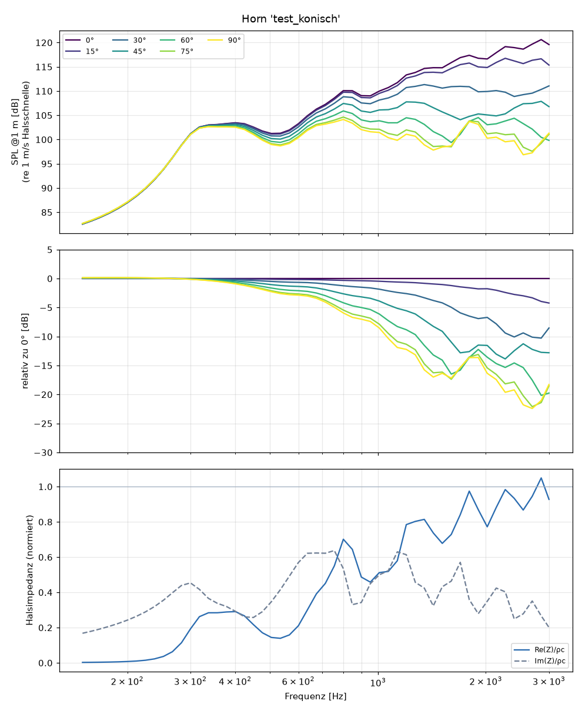
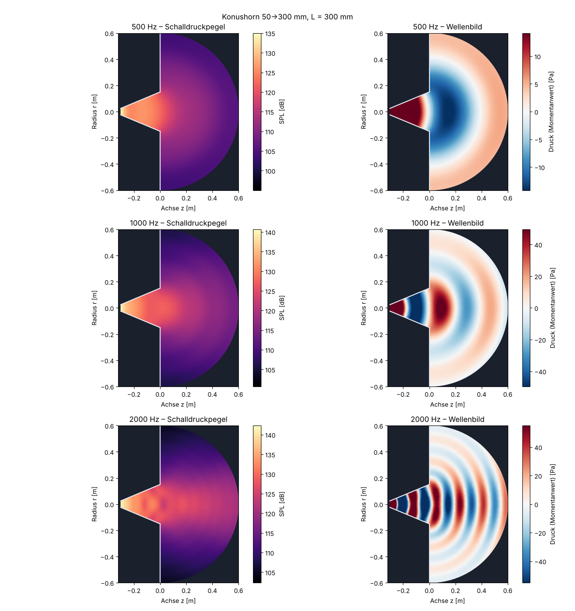

# elmer-horn – Hornsimulation mit Elmer FEM für Claude

Ein lokaler **MCP-Server**, mit dem Claude (oder jeder andere MCP-fähige KI-Assistent)
rotationssymmetrische **Lautsprecherhörner** in der freien FEM-Software
[Elmer](https://www.elmerfem.org/) simulieren kann – von der Geometrie bis zum fertigen
Frequenzgang-Plot, gesteuert in normaler Sprache.

> „Leg ein OS-Horn mit 25-mm-Hals, 90° Abstrahlwinkel und 120 mm Länge an,
> rechne 300 Hz bis 10 kHz und zeig mir Frequenzgänge und Halsimpedanz.“

Der Connector erledigt dann die ganze Kette:

```
Profil  →  Gmsh-Geometrie (.geo)  →  Netz (Gmsh → ElmerGrid)
        →  Frequenz-Sweep (ElmerSolver, Helmholtz, achsensymmetrisch, parallel)
        →  Auswertung (SPL unter 0–90°, Halsimpedanz)  →  Plots
```



*Beispiel: Konushorn, Hals Ø 50 mm, Mündung Ø 300 mm, Länge 300 mm.
Oben: Pegel unter 0–90°, Mitte: Richtwirkung relativ zur Achse, unten: normierte Halsimpedanz.*



*Dasselbe Horn als Feldbild: links der Pegel, rechts der Momentandruck (Wellenfronten).*

---

## Warum?

Hörner per FEM zu simulieren ist mächtig, aber der Einstieg ist zäh: Geometrie skripten,
Netz erzeugen, Randbedingungen in Solver-Input-Dateien schreiben, Ergebnisse aus
Textdateien kratzen und auswerten. Kommerzielle Tools kosten viel Geld, und die freien
(ATH, AKABAK, Elmer pur) haben eine steile Lernkurve.

Dieser Connector packt den ganzen Ablauf in ein paar Werkzeuge, die eine KI aufrufen kann.
Man beschreibt das Horn, und die KI kümmert sich um Netz, Solver und Auswertung – und kann
dabei auch erklären, *was* in den Ergebnissen zu sehen ist.

## Was kann er?

| Werkzeug | Was es macht |
|---|---|
| `check_setup` | Prüft, ob ElmerSolver, ElmerGrid, gmsh und matplotlib gefunden werden. Immer zuerst. |
| `create_horn` | Legt ein Projekt an: Profil berechnen, Geometrie schreiben, vernetzen. |
| `run_sweep` | Frequenz-Sweep, jede Frequenz als eigener Solver-Prozess, parallel auf mehreren Kernen. |
| `get_results` | Ergebnistabelle: SPL unter 0/15/30/45/60/75/90° und Halsimpedanz (Re/Im). |
| `plot_results` | Plot mit Frequenzgängen, normierter Richtwirkung und Halsimpedanz (PNG). |
| `plot_field` | Rechnet das komplette Schallfeld für 1–4 Frequenzen und rendert Pegel- und Wellenbild. VTU-Dateien für ParaView bleiben erhalten. |
| `list_projects` | Übersicht aller Hornprojekte. |
| `read_project_file` / `write_project_file` | Projektdateien lesen/schreiben, z. B. `mesh.geo` von Hand anpassen oder Logs ansehen. |
| `run_command` | ElmerSolver, ElmerGrid oder gmsh mit eigenen Argumenten starten (Sonderfälle, Fehlersuche). |

### Hornprofile

| `profile` | Parameter | Beschreibung |
|---|---|---|
| `conical` | `mouth_diameter_mm` | Kegel, Radius steigt linear |
| `exponential` | `mouth_diameter_mm` | Exponentialhorn |
| `hyperbolic` | `mouth_diameter_mm` | Hypex nach Salmon (T = 0,7) |
| `os` | `coverage_angle_deg` | Oblate Spheroidal (Geddes), voller Abstrahlwinkel z. B. 90 |
| `custom` | `profile_points_mm` | Eigenes Profil als Liste `[[z_mm, r_mm], …]`, z vom Hals (0) zur Mündung |

Gemeinsam: `throat_diameter_mm`, `length_mm`. Optional: `f_max_hz` (bis zu welcher Frequenz
das Netz fein genug sein soll, Standard 5000), `elements_per_wavelength` (Standard 10),
`domain_radius_m` (Größe des Luftraums, Standard automatisch).

## Was wird simuliert? (Kurzfassung)

- Horn in einer **unendlichen Schallwand** (Halbraum), **achsensymmetrisch** – gerechnet wird
  also nur ein 2D-Halbschnitt, das ist schnell.
- Am Hals sitzt ein **Kolben mit konstanter Schnelle 1 m/s**. Die Pegel sind deshalb
  „dB re 1 m/s Halsschnelle“ – ideal zum **Vergleichen von Hornvarianten**, aber *kein*
  Frequenzgang mit einem echten Treiber.
- Hornwand und Schallwand sind schallhart, der Außenrand des Luftraums ist absorbierend.
- Ausgewertet werden der Pegel auf 1 m umgerechnet unter 0–90° und die über den Hals
  gemittelte, auf ρc normierte **Halsimpedanz**. Re(Z) ≈ 1 heißt: Das Horn belädt den Treiber gut.

Ausführlich mit Formeln, Annahmen und Grenzen: **[docs/MODELL.md](docs/MODELL.md)**.

## Installation (Windows)

Getestet unter Windows mit Elmer 26.2, gmsh 4.15.2 und Python 3.11.
Unter Linux/macOS sollte es auch laufen, solange die Programme im `PATH` liegen
oder per Umgebungsvariable angegeben werden (siehe unten) – ausprobiert ist das noch nicht.

### 1. Elmer installieren

Windows-Installer von <https://www.elmerfem.org/> bzw. den
[GitHub-Releases](https://github.com/ElmerCSC/elmerfem/releases) herunterladen und installieren.
Der Connector findet Installationen wie `C:\Program Files\Elmer 26.2-Release` automatisch.

### 2. Gmsh herunterladen

Von <https://gmsh.info/> das Windows-Paket laden und z. B. nach `C:\ElmerHorn\gmsh\` entpacken.

### 3. Connector einrichten

Python **3.10 oder neuer** wird benötigt.

```powershell
cd C:\ElmerHorn
git clone <repo-url> connector
cd connector
python -m venv .venv
.venv\Scripts\pip install -r requirements.txt
```

### 4. In Claude Desktop eintragen

In Claude Desktop unter *Einstellungen → Entwickler → Konfiguration bearbeiten* die Datei
`claude_desktop_config.json` öffnen und den Block aus
[`claude_desktop_config.example.json`](claude_desktop_config.example.json) unter
`"mcpServers"` einfügen. Pfade an die eigene Installation anpassen:

```json
{
  "mcpServers": {
    "elmer-horn": {
      "command": "C:\\ElmerHorn\\connector\\.venv\\Scripts\\python.exe",
      "args": ["C:\\ElmerHorn\\connector\\server.py"],
      "env": {
        "HORN_WORKDIR": "C:\\ElmerHorn\\projekte",
        "GMSH_EXE": "C:\\ElmerHorn\\gmsh\\gmsh.exe"
      }
    }
  }
}
```

Claude Desktop neu starten und fragen: *„Führe check_setup vom elmer-horn-Connector aus.“*
Steht bei allen drei Programmen ein Pfad statt `NICHT GEFUNDEN`, ist alles bereit.

### Umgebungsvariablen

| Variable | Bedeutung | Standard |
|---|---|---|
| `HORN_WORKDIR` | Ordner für alle Projekte | `~/ElmerHorn` |
| `GMSH_EXE` | Pfad zu `gmsh.exe` | Suche in `PATH` und Programmordnern |
| `ELMER_SOLVER` | Pfad zu `ElmerSolver.exe` | Suche in `PATH`, `ELMER_HOME`, Programmordnern |
| `ELMER_GRID` | Pfad zu `ElmerGrid.exe` | wie oben |
| `ELMER_HOME` | Elmer-Installationsordner | – |

## Beispiele für Anfragen

- „Vergleich ein Exponential- und ein Konushorn mit gleichem Hals (25 mm), Mündung (200 mm)
  und Länge (150 mm) von 500 Hz bis 8 kHz. Welches belädt den Treiber unten herum besser?“
- „Ich will ein Horn für einen 1-Zoll-Treiber mit 90° Abstrahlung ab ca. 1 kHz.
  Schlag ein OS-Profil vor, rechne es durch und zeig mir die Richtwirkung.“
- „Zeig mir das Wellenbild von `test_konisch` bei 500, 1000 und 2000 Hz.“
- „Der Sweep bei 3 kHz ist fehlgeschlagen – schau ins Log und find raus, warum.“

## Tipps

- **Netzfeinheit:** `f_max_hz` bei `create_horn` mindestens so hoch wie die obere
  Sweep-Frequenz setzen. `run_sweep` warnt, wenn man darüber hinaus rechnet.
- **Rechenzeit:** Standardmäßig läuft die Hälfte der logischen Kerne parallel (`workers`).
  Hohe Frequenzen = feines Netz = deutlich länger.
- **Mündungsfrequenz:** `create_horn` gibt einen Faustwert für ka = 1 an. Darunter strahlt die
  Mündung schlecht ab, die Halsimpedanz bricht ein (im Beispiel oben gut zu sehen).
- **ParaView:** `plot_field` lässt die `.vtu`-Dateien im Projektordner – damit kann man
  das Feld in [ParaView](https://www.paraview.org/) frei untersuchen.

## Grenzen (Version 1)

- Nur **rotationssymmetrische** Hörner. Rechteckige Hörner, Waveguides mit unterschiedlichem
  horizontalem/vertikalem Winkel oder Bass-Reflex-Gehäuse gehen damit nicht.
- Nur **unendliche Schallwand**. Hörner im freien Raum oder in endlichen Gehäusen
  (Kantenbeugung!) sind nicht abgebildet.
- **Idealer Kolben** als Quelle, kein Treiber-Modell (keine Thiele-Small-Parameter,
  keine Kompressionskammer, kein Phase Plug).
- **Verlustfrei:** keine Reibung oder Dämpfung in der Luft.

## Sicherheit

Der Server läuft lokal mit den Rechten des Benutzers. Er schreibt nur innerhalb von
`HORN_WORKDIR` und startet nur ElmerSolver, ElmerGrid und gmsh. Aber Achtung:
`write_project_file` + `run_command` erlauben, beliebige `.geo`- und `.sif`-Dateien zu
schreiben und auszuführen – und Gmsh-Skripte können über `SystemCall` Befehle auf dem
Rechner ausführen. Den Connector deshalb nur mit einem KI-Assistenten verwenden, dem man
vertraut, und Tool-Aufrufe im Zweifel bestätigen statt automatisch freigeben.

## Lizenz

MIT – siehe [LICENSE](LICENSE). Elmer und Gmsh stehen unter eigenen Lizenzen (GPL) und sind
nicht Teil dieses Projekts.

## Danke

- [Elmer FEM](https://www.elmerfem.org/) vom CSC – IT Center for Science, Finnland
- [Gmsh](https://gmsh.info/) von Christophe Geuzaine und Jean-François Remacle
- Das [Model Context Protocol](https://modelcontextprotocol.io/) für die Anbindung an KI-Assistenten
